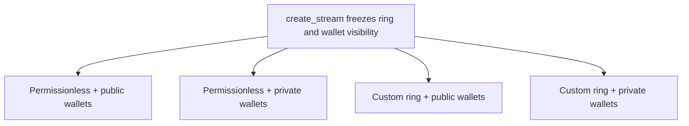
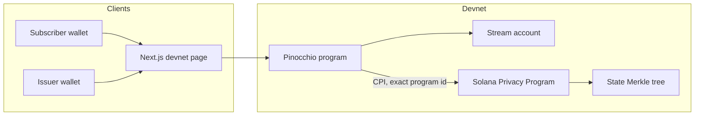
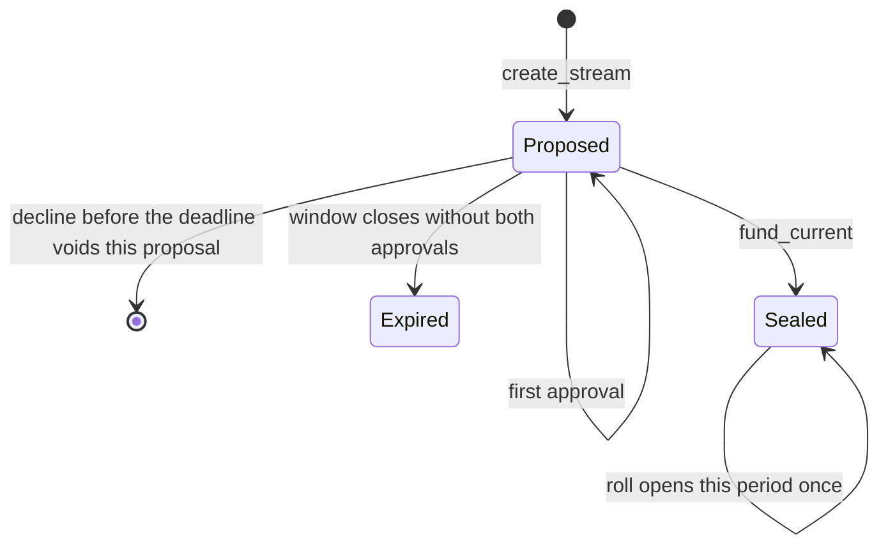
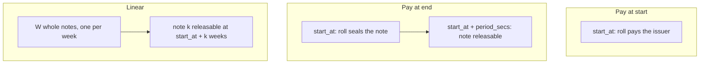

# Escrow, then payroll, vesting, and subscription

The first tool is escrow, and it is the weekend demo on devnet for 6–8 November 2026. Two people exchange assets. Each side locks what they are giving: a token, or an NFT as a Token-2022 or SPL amount of 1. Both approve before the start. As soon as both locks are sealed, either side can release and take the other side's asset. If the other side never locks, the first side reclaims after the deadline. A sealed side has no cancel. Sunday shows that path: Confidential on the permissionless Default ring, in Pinocchio.

The sequence after escrow is payroll, then vesting, then subscription. Escrow stays `pescrow`. Payroll is `pproll`, a separate program: one salary stream, the employer funds a shielded note, and the employee claims it. Vesting is the partial claim after payroll, on `pproll`, not a third program. A bonus can sit there as a second vested stream, not as its own launch. Subscription is last: a next-period approval window, pay at start or pay at end, and a recurring roll. It is supported and it is not the demo. Fee redistribution stays in the backlog. It uses the same partial-claim shape as vesting and is not a weekend blocker.

Ring and wallet visibility are separate choices, frozen at create. The permissionless ring or a custom ring can be paired with public wallets or private wallets. The permissionless ring prints both wallets, so the private choice on that ring is rejected until a transfer there can omit the owner. A custom ring can be opened either way, and both wait on the ring program id from Helius. Friday through Sunday do not wait on that reply. The path that ships is the permissionless ring with public wallets. Company tooling comes later: a fuller dashboard, an API, an MCP server, and CPI from other programs. This weekend the target is the on-chain program and a thin devnet dashboard.

The program language is Pinocchio. The crate stays Pinocchio even when the sample we run is written differently. Record that difference when the sample is run, and keep this document as the source of truth.

## Primary use

The order is escrow, then payroll, then vesting, then subscription.

Escrow is the first tool and the Sunday demo. Two parties exchange assets. Each locks a note: fungible tokens, or an NFT as a supply-1 token. Once both notes are locked, either side can release and take the other side's asset. A side that locked can reclaim after the deadline if the other side never locks. There is no cancel once that side is sealed. The path is Confidential on the Default ring, in Pinocchio.

Payroll is next, in `pproll`, not in the escrow program. One employer and one employee. Both approve. The employer funds each period from their own shielded balance. The employee claims that note when the period ends. The amount stays in the note. A funded period has no cancel. `stop` only blocks a later fund. The account layout is in `pproll/README.md`. It is not the first escrow demo.

Vesting follows payroll, on `pproll`. `claim_vested` releases one elapsed weekly note. The locked remainder stays sealed. A cliff is optional. With no cliff, notes unlock on their week. With a cliff, nothing is claimable before `cliff_end`. At the cliff, every note whose week has already elapsed becomes claimable, and later weeks still wait. A bonus can sit on the same payer as a second vested stream. It is not a separate product launch.

Subscription is last. The next period has its own approval window. Pay at start and pay at end are both supported, and `roll` can recur. Subscription is not the weekend demo.

Fee redistribution is the same partial-claim shape as vesting, funded by the fee payer. Fees land in the payer's funded position. Entitlements unlock over time or in bumps. Recipients partial-claim the unlocked share only. It is backlog, not a separate program, and not a weekend blocker.

## Modes

Two choices are frozen at `create_stream`. A stream does not migrate.

The ring is the permissionless Default ring, or a custom ring Helius opens. Wallet visibility is public or private. The four combinations are all product options. Amount and asset stay in the note whenever a ring is used.



| Ring | Wallets | What create does |
| --- | --- | --- |
| Permissionless | Public | Opens. Amount stays in the note. Both wallets are stored and are also printed by the Default ring. This is the path that can run today. |
| Permissionless | Private | Rejected. That ring prints the sender and recipient. A commitment on this account would not hide them. |
| Custom | Public | Option. Opens when Helius gives that ring's program id. Wallets stay on the account. Amount stays in the note. |
| Custom | Private | Option. Opens when Helius gives an anonymous ring program id. The account stores commitments, not pubkeys. A relayer pays the fee. |

There is also a no-ring public mode. Mint, amount, wallets, and schedule sit on the account in plaintext. It is not one of the four ring options.

### Permissionless ring, public wallets

The Helius Default ring. Program id: `sppU489D7A4U1exNo1oeMGZtLEofq3a6o2fR7UeoWB6`.

Asset and amount are encrypted in the note. The recipient can decrypt the token and amount of a payment made to them, because the note is encrypted to their viewing key. The sender can read what they sent and their change. Another participant in the ring sees ciphertexts and the two public addresses, and cannot decrypt the amount, asset, or memo. There is no auditor.

Schedule (`start_at`, approval deadline, period) is public on the stream account. The slot a transaction lands in is always public.

### Permissionless ring, private wallets

The choice exists. `create` returns `PermissionlessPublishesWallets` and does not initialize the account. Turning it on requires a permissionless transfer that does not print the owner. This program will not store a commitment and call the wallet private while the ring prints it.

### Custom ring

Helius creates the ring. This program does not. Public wallets and private wallets are both options on a custom ring.

Public wallets use a confidential custom ring. The account stores the two pubkeys. Private wallets use an anonymous custom ring: commitments on the account, a relayer as the fee payer, no auditor, no permanent delegate, no freeze. The ring program id stays public. Landing time stays public. Participants still cannot read each other's notes.

Until the matching program id is set, `create` returns `CustomRingUnset` for both wallet choices. A confidential custom ring does not satisfy the private-wallet option. The dashboard shows a private counterparty only to the connected wallet, from local decryption.

## Ask already sent to Helius

The request is already with Helius: a devnet custom ring for testing, with a public-wallet opening and a private-wallet opening, no auditor, no permanent delegate. Until those program ids exist, `create` rejects every custom ring. The permissionless ring with public wallets is the path that can be built today. Private wallets on that ring stay rejected.

## Addresses

| Piece | Value |
| --- | --- |
| Privacy docs | https://www.helius.dev/docs/privacy |
| Example to run first | [helius-labs/zolana-examples](https://github.com/helius-labs/zolana-examples), escrow-program (timelock) |
| Solana Privacy Program | `sppU489D7A4U1exNo1oeMGZtLEofq3a6o2fR7UeoWB6` |
| User registry | `regyS5rkAcw2YzDJCmTwCTHs2s246FXxbmuRZ42u2PD` |
| State Merkle tree, devnet | `33KVhbT4QtdQDrrrGwwThqD47Dh4Q6tA443t9jMNcWFN` |

These addresses come from Helius. This document does not invent Privacy Program instruction layouts. A lock, a swap, and a return each verify a circuit whose public inputs are read from the escrow account, then `SppTransactAccounts::invoke` moves the note. The locked note is owned by this program's PDA (`escrow-lock` plus the escrow address). The program signs that PDA on the swap and the return. The seal is written only after the invoke succeeds. Handlers stay Pinocchio. The Anonymous ring program id is unset until Helius opens the test ring. Do not invent one.

## Default ring

The Default ring is the permissionless pool. There is no gatekeeper. Public wallets are the option this ring can honor today.

- Asset and amount are confidential: they sit encrypted inside the note.
- With public wallets, sender and recipient are public. Private wallets are rejected on this ring.
- Custody is self-custodial: the owner must sign spends.
- The ring has no auditor, no whitelist, and no freeze authority.
- Anyone can deposit to a shielded address.

A ring is a shared pool of notes encrypted to each owner's viewing key. Another participant can see ciphertexts. On the permissionless ring with public wallets they also see the sender and recipient. They cannot decrypt someone else's amount, asset, or memo. The Default ring has no auditor key.

The dashboard decrypts only notes for the connected wallet. Viewing keys stay on that client. No server collects them.

Helius creates custom rings. Each custom ring is opened as public wallets or private wallets. An auditor, a whitelist, freeze, a co-signer, and a permanent delegate stay outside this design. All rings share one Merkle tree. Two custom rings route through the Default ring. This program does not create a ring per user or a ring per need.

## What stays private

Privacy holds while value stays inside a ring. A public deposit or a public withdraw reveals asset, amount, and parties. The no-ring mode has no pool, so the stream account itself is the disclosure. Wallet visibility does not follow from which ring you picked.

| Fact | No ring | Public wallets, either ring | Private wallets |
| --- | --- | --- | --- |
| Amount and asset | Plaintext on the stream account. | Encrypted in the note. Not stored on the stream account. The recipient decrypts a payment made to them. The sender reads what they sent and their change. | Same as public wallets. The note is still encrypted. |
| Sender and recipient | Plaintext pubkeys on the stream account. | Plaintext pubkeys on the stream account, and printed by the ring transfer. | Commitments on the stream account. A relayer pays the fee. On the permissionless ring this option is rejected, because that ring prints the wallets. |
| Memo | Plaintext account fields. | Encrypted in the note. | Encrypted in the note. This design asks for no auditor key. |
| Schedule | Public on the stream account. | Public on the stream account, so the clock can be read without an extra proof. | Public on the stream account. |
| Landing time | Public. | Public. | Public. A custom ring's program id is public too. |

Hiding the schedule would mean committing the deadline inside the note and proving `Clock >= deadline`. That work is out of scope.

## Shape

Escrow is one Pinocchio program, `pescrow`. Payroll is a second program, `pproll`. The layout below was an earlier combined stream. It is not the payroll account. Payroll's stream and period accounts are in `pproll/README.md`. Vesting later uses `pproll`. In Confidential and Anonymous, notes live in the privacy pool, and after funding the program owns the notes. The price never lands in plaintext on the stream in those two modes. Public stores mint and amount on the stream account and does not use a ring.

The subscriber signs `fund_current` and each open that moves value under the frozen terms. After that, `roll` is permissionless: the frozen terms and the earlier signature are the authorization. `roll` pays or seals under the clock. It does not ask for a new price.





`Lapsed` is a status on the account. The transitions specified for this weekend are the ones in the diagram: create, approve, decline, fund, expire, and a single roll. A failed next period leaves the current note locked. That constraint is below, under release rules.

## Stream account

The program owns the account. The instruction names it. A swapped stream is a different account and must fail. Read `visibility` before decoding mint, amount, or the party fields.

Field order:

| Field | Type | Rule |
| --- | --- | --- |
| `visibility` | `Public` \| `Confidential` \| `Anonymous` | Written at `create_stream`. Frozen with the other terms. A stream does not migrate. |
| `subscriber` | `Pubkey` or commitment | Pubkey in Public and Confidential. Commitment in Anonymous, not a pubkey. |
| `issuer` | `Pubkey` or commitment | Same split as `subscriber`. |
| `mint` | `Pubkey` | Stored in Public. Not stored in Confidential or Anonymous. |
| `amount` | `u64` | Stored in Public. Not stored in Confidential or Anonymous. |
| `start_at` | `i64` | Unix time the period locks and `roll` may open it. |
| `approval_deadline` | `i64` | Must be `<= start_at`. |
| `period_secs` | `i64` | Length of the period. Pay-at-end releases at `start_at + period_secs`. |
| `mode` | `PayStart` \| `PayEnd` \| `Linear` | Chosen before terms freeze. This is the pay mode, not visibility. |
| `week_count` | `u16` | `W`, the number of weekly notes in Linear mode. |
| `subscriber_approved` | `bool` | Set only by the subscriber. |
| `issuer_approved` | `bool` | Set only by the issuer. |
| `terms_frozen` | `bool` | Set when the second approval lands. |
| `status` | `Proposed` \| `Sealed` \| `Expired` \| `Lapsed` | See the instructions. |
| `bump` | `u8` | Bump of this program-owned account. |

Public stores mint, amount, both party pubkeys, and the schedule. Confidential and Anonymous do not store amount or mint. Anonymous stores `subscriber` and `issuer` as commitments. Storing pubkeys in Anonymous undoes the masking.

Approve and decline signer checks differ. Confidential and Public compare signers to stored pubkeys. Anonymous must bind the signer to the commitment inside the proof. If that proof is not ready when Helius opens the ring, Anonymous waits, and Confidential still ships.

## Instructions

Each bullet is a check that needs a failing test, or a success condition the same tests pin down. Build the tests with the handlers.

### `create_stream`

Creates the stream in `Proposed`. The account is owned by this program. The handler writes `visibility` and does not change it later. Public writes mint, amount, and both pubkeys. Confidential writes both pubkeys and writes no amount and no mint. Anonymous writes party commitments and writes no amount and no mint. Until the test ring exists, `create_stream` rejects Anonymous.

Failing tests:

- `approval_deadline` after `start_at` fails.
- An account owned by any other program fails.
- Anonymous fails while the test ring program id is unset.
- A later change to `visibility` fails.

### `approve`

The subscriber's signature sets `subscriber_approved` and leaves the issuer flag alone. The issuer's signature sets `issuer_approved` and leaves the subscriber flag alone. The second approval sets `terms_frozen`. After that, `mode`, `start_at`, and `period_secs` stay as written. `visibility` stays as written from create.

Public and Confidential compare the signer to the stored pubkey. Anonymous binds the signer to the commitment inside the proof.

Failing tests:

- A third-party signer fails. On Public and Confidential the check is the stored pubkey. On Anonymous the check is the proof binding.
- A signature at or after the approval deadline fails.
- A signature at or after `start_at` fails.
- A later change to `mode`, `start_at`, or `period_secs` fails once `terms_frozen` is set.

### `decline`

Either party may decline, and only before the deadline. The signer check matches `approve`: stored pubkeys in Public and Confidential, and the commitment binding inside the proof in Anonymous. Decline voids this proposal. An older sealed period on another stream stays untouched.

Failing tests:

- A decline at or after the deadline fails.
- A decline of this proposal leaves a previously sealed period unchanged.

### `fund_current`

The subscriber signs. The stream is this program's account, and it is the account named in the instruction. On success the status becomes `Sealed`. In Confidential and Anonymous the amount stays in the note. Public records the plaintext amount on the stream account and does not CPI.

Confidential CPIs into the Solana Privacy Program only when the program id is exactly `sppU489D7A4U1exNo1oeMGZtLEofq3a6o2fR7UeoWB6`. Any other id fails closed. Anonymous, once the test ring is configured, fails closed unless the CPI program id is that ring's id.

Failing tests:

- A signer other than the subscriber fails.
- A swapped stream fails.
- A stream that is already `Sealed` fails.
- A CPI whose program id is anything other than the Solana Privacy Program id fails on the Confidential path.

### `roll`

`roll` is permissionless. Before `start_at`, it moves no funds. If the approval window closed without both approvals, status becomes `Expired` and nothing opens.

On the start date, with both approvals and frozen terms, `roll` opens the period once:

- `PayStart`: pay the issuer.
- `PayEnd`: seal a note releasable at `start_at + period_secs`.
- `Linear`: create `W` equal notes. Note `k` is releasable at `start_at + k` weeks.

A second `roll` does not open a second set. A due note from a previous period still settles.

Failing tests:

- `roll` before `start_at` moves no funds.
- A closed window without both approvals sets `Expired` and opens nothing.
- A second `roll` does not create a second set of notes.
- A due note from a previous period still settles on a later `roll`.

### `claim_vested`

`count == 1` releases only the oldest elapsed note. A larger count releases every elapsed unclaimed note and does not release a future week. Claiming week 1 does not make week 2 due.

Failing tests:

- A count of 1 leaves every newer elapsed note unclaimed.
- A count that covers all elapsed notes leaves a future week locked.
- After week 1 is claimed, week 2 stays locked until its own time.

### Release rules that apply to every mode

A sealed period has no cancel instruction. Decline, or missing approval, on the next period must not unlock the current note. An early withdraw fails.

```mermaid
sequenceDiagram
  participant Sub as Subscriber
  participant Iss as Issuer
  participant P as Stream program
  participant SPP as Privacy program

  Sub->>P: create_stream
  Sub->>P: approve
  Iss->>P: approve
  Note over P: terms_frozen
  Sub->>P: fund_current
  P->>SPP: CPI only if program id matches
  Note over P: Sealed; Confidential keeps the amount in the note
  P->>P: roll at start_at, permissionless, once
  P->>P: claim_vested for elapsed notes
```

## Pay modes

All three pay modes lock at the start date. They differ in when value becomes releasable. Pay mode is independent of visibility.



- Pay at start. `roll` pays the issuer on `start_at`.
- Pay at end. `roll` seals on `start_at` and the note is releasable at `start_at + period_secs`.
- Linear. Weekly whole notes. A bump claims one elapsed week. A linear claim claims every elapsed week.

Per-second streaming is out of scope. It would need a vesting proof this program does not build.

## Funding

The hackathon path is the subscriber's own shielded balance on the Default ring. They sign `fund_current`, and they sign each open. That path is Confidential.

A program-owned budget vault is a stretch, tracked as Linear BIB-16. It is not part of the required path in this architecture.

## Dashboard

One Next.js page, pointed at devnet. It can propose terms, show approval state, approve, decline, and claim.

The Sunday demo is a sealed Confidential escrow: both parties approve, the payer funds the note, the sealed period cannot be cancelled, and once both sides are locked either party can release. The deadline only lets a lone lock be reclaimed. Payroll, vesting, and subscription follow that path and are not that demo. For Confidential the page shows the public stream fields: parties, schedule, pay mode, approvals, and status. It does not render an amount read from the stream account, because Confidential does not store one. Public would show mint and amount from the account. Anonymous shows the counterparty only to the connected wallet, from local decryption. The page does not replace the Pinocchio tests. Those tests are the contract.

## Why this shape

Users on the Default ring share one permissionless pool, so one user cannot read another's notes. Escrow is the swap program. Payroll is its own program, so a salary claim cannot be read as one side of a swap. Vesting later is a partial claim on `pproll`. A fee position uses that partial claim and stays backlog.

Confidential publishes the parties on the stream account and keeps the price in the note. Anonymous hides the relationship only when that account stores commitments and the custom ring is the one Helius opened. Public keeps mint, amount, parties, and schedule on the account. `roll` enforces the frozen contract with `Clock`, the status, and, in the ring modes, the note release times.

## Risk

Confidential publishes the relationship and the calendar while hiding the price. Anonymous hides the relationship only when the stream account stores commitments and Helius has opened that ring. Landing time is public in every mode.

## Implementation note

CPI depth and transaction size matter only at the Linear open. If `W` weekly proofs do not fit in one transaction, create the notes in a short sequence. The subscriber signs that open. A later `roll` still must not open a second set, and a due note from an earlier period still settles.

## Out of scope

Anonymous is a product mode in this program. It is gated on Helius opening the test ring. It is not a second program, and it is not required for the weekend demo.

Still out of scope:

- Per-second vesting proofs
- Auditor keys, a permanent delegate, freeze, a whitelist, and a co-signer
- A ring per user or a ring per need
- MCP, a public HTTP API, and CPI from other product programs
- Multiple recipients on one vault
- A cancel instruction on a sealed period
- The program-owned budget vault, Linear BIB-16, as a required path
- Reading a Confidential or Anonymous price from the stream account in the dashboard

## Weekend order

The order is the weekend. Each day ends with tests that match the checks above. Write nothing that contradicts this document. If the timelock sample uses a different crate layout, record that and keep this program in Pinocchio. Do not block Friday, Saturday, or Sunday on Helius replying.

### Friday 6 November

Run the stock Helius timelock from `helius-labs/zolana-examples`, escrow-program, on devnet. Confirm the Privacy Program id, the user registry, and the devnet state tree against the table in this document.

Scaffold the Pinocchio crate. The first test is the wrong-owner test: an account this program does not own fails. No stream logic beyond that test.

### Saturday 7 November

Add the stream account in the field order above. Implement `create_stream`, `approve`, `decline`, `fund_current`, and `roll` for `PayStart` and `PayEnd`. The path that has to pass on Saturday is Confidential. `create_stream` rejects Anonymous while the test ring program id is unset.

Saturday is done when these fail or pass as specified: deadline after `start_at`, third-party approve, approve at or after the deadline, approve at or after `start_at`, frozen terms reject a later edit, a change to `visibility` fails, decline leaves an older sealed period alone, swapped stream, already sealed, CPI program id other than `sppU489D7A4U1exNo1oeMGZtLEofq3a6o2fR7UeoWB6`, `roll` before `start_at`, expiry when the window closes without both approvals, pay-at-start pays the issuer on `start_at`, pay-at-end seals a note releasable at `start_at + period_secs`, and a second `roll` does not open a second set.

### Sunday 8 November

The demo is a sealed Confidential escrow on the Default ring. Both parties approve before the start. The payer funds the note. The sealed period cannot be cancelled. Once both sides are locked, either party can release. A lone lock is reclaimed only after the deadline. The devnet page shows propose, approval state, approve, decline, fund, and release. It does not show a price taken from a Confidential stream account.

Sunday is done when that escrow can be funded from the payer's shielded balance and released as soon as both sides are locked on the page, with the Pinocchio tests still covering every check in this document. Payroll, vesting, and subscription are not required for Sunday to be done. Anonymous is enabled in the same program when the test ring program id is configured, and is not required for Sunday to be done.

After that release path works, the order is payroll, then vesting, then subscription. Payroll is `pproll`: the employer funds a period note, and the employee claims it after the period ends. Vesting is a later partial claim on that same program. Those checks do not gate the escrow demo.
