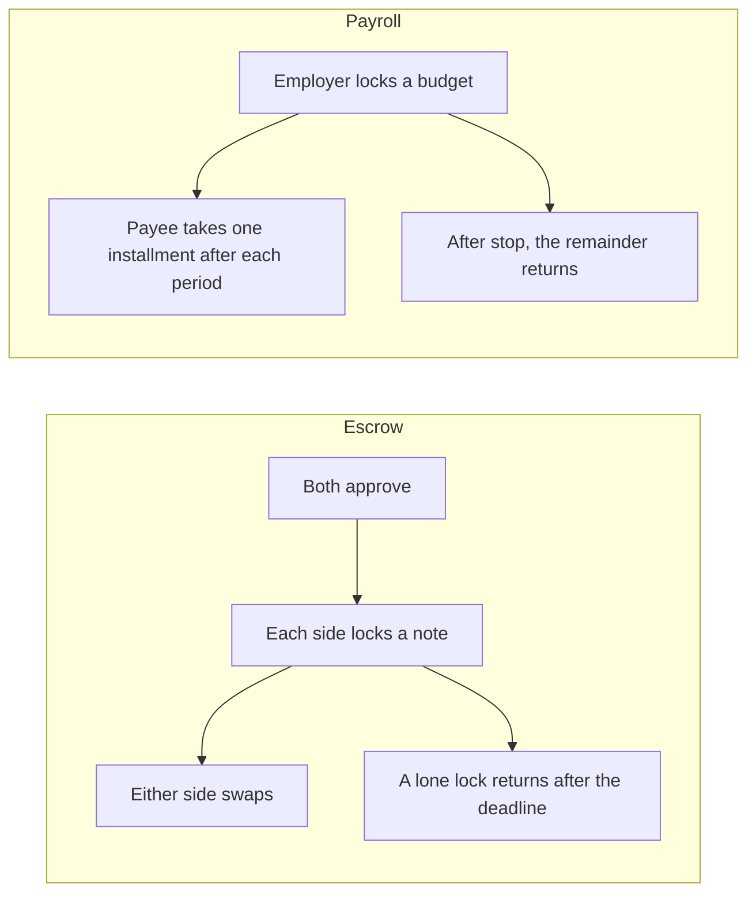

# Settle the deal. Keep the terms quiet.

A short paper on Privacy. Escrow and payroll are built, as two programs. Vesting and subscription are not. The price stays in a shielded note. The wallets and the clock do not.

## Vision

A payment on Solana settles in public. The amount, the asset, the two wallets, and the moment it landed become a dataset. Escrow and payroll are deals of that shape: someone locks value, someone else becomes able to take it, and a clock decides when.

Privacy is the tooling that still settles those deals. The commercial terms sit in a shielded note. The contract stays enforceable. The price does not sit on an account anyone can open.

Salary size and what an exchange was worth are not the product. Settlement is.

## What a stranger can read

Privacy holds while value stays inside a ring. A ring is a shared pool of notes. Each note is encrypted to its owner's viewing key. Two people in the same pool cannot read each other's notes.

Two choices are frozen when a position is created. A position does not migrate.

- **Ring.** The permissionless ring is open to anyone. A custom ring is a pool opened for a narrower use, such as a company. Neither program deploys a new program per ring, and neither opens a ring per person.
- **Wallets.** Public stores both addresses. Private would store commitments, and a relayer would pay the fee.

Amount and asset stay in the note. Wallet privacy is the other choice, and the path that opens today does not have it. The permissionless ring prints both addresses, so hiding them only on our account would be a false claim. Private wallets on that ring are rejected. A custom ring is rejected until its program id is set.

| Fact | What opens now | Custom ring, private wallets |
| --- | --- | --- |
| Amount and asset | In the note. The two parties can read their own. A stranger cannot. | Same. Not open yet. |
| The two wallets | Public. | Commitments. Not open yet. |
| Schedule | Public, so the program can read the clock. | Public. |
| When a transaction lands | Public. | Public. |

A deposit into the pool from a public balance, or a withdraw back out, reveals the asset, the amount, and the parties. There is no auditor key, no freeze, and no whitelist. Viewing keys stay on the client. The page decrypts only the notes that belong to the connected wallet.

The anonymity set is the size of the pool. A custom ring can scope that pool to a company or a payroll. A tiny ring is a worse set. This is not a decoy system.

## Two programs

Escrow and payroll do not share an account. A swap spends both notes. A salary spends one budget, one installment at a time. One account cannot be both.

Each position is owned by its own program. Terms freeze once both sides have approved. A note moves only after the program has checked a proof against that account. The record of the move is written after the note has moved.

Both tools run from a connected wallet. Vesting and subscription have a page and no program.

## Escrow

Two people exchange a token, or an NFT as a supply-1 token. Each side states what they give. Neither amount is stored on the account.

Both approve before the start. Then each side locks. The first lock can land once both have approved. The second lock can land only after the first is sealed. A lock checks a proof, moves that side's note into an account this program owns, and marks the side sealed only after the move returns.

Once both notes are locked, either side can swap. Each party receives the other's note. The clock is not checked again for the swap.

If the other side never locks, the side that did lock takes their note back after the deadline. A sealed side has no cancel before that, and no cancel once both sides are in.

A stranger can see who is swapping and the deadline. They cannot see the price.

## Payroll

One employer, one payee, one cadence. This is not an escrow. The programs do not share a note.

The employer first holds a shielded budget of their own. A payroll draws from that budget. Opening the payroll is the employer's approval. The payee approves before the start and binds the shielded address that will receive the pay. The employer cannot choose that address. Until the payee has bound it, the budget cannot lock.

The installment and the budget are commitments. The stream stores no amount and no mint. The two wallets, the start, and the length of a period are public and freeze with the approvals.

The employer then locks the budget onto the payroll. After each period ends, the payee takes one installment. Period `k` can be paid when the clock is at or after `start + (k + 1)` periods. The remainder stays on the payroll. Pay is at the end of the period, not at the start.

The employer can stop later installments. An installment already paid does not come back. After a stop, the unspent budget returns to the employer's pool. It does not return while the payroll is still running.

A stranger can see who pays whom, and when a period ends. They cannot see the installment or the budget.

## Not built

Vesting is a grant that unlocks on a schedule. Subscription is a charge that opens again each period. Both are named. Neither has a program, and neither dashboard is open. They are not a mode of payroll. A payroll installment is the whole period's pay, not a slice of a grant.

## What this is not

- A price stored on the account and called private.
- Wallet privacy on the permissionless ring.
- A ring per user. A pool of one is not a pool.
- An auditor, a freeze, a whitelist, a co-signer, or a permanent delegate.
- A cancel on an escrow note that is already locked.
- A way for the employer to take back an installment the payee has already received.
- Per-second streaming. Payroll pays a whole installment when the period ends.

## Risk

The path that opens publishes who is dealing and the calendar, and hides the price. Hiding the parties waits on a custom ring. The moment value moves is public.

On a payroll, a future installment is not yet the payee's. Stop ends later pays, and the unspent budget goes back to the employer. A reader who needs the parties hidden, the payday hidden, or a salary that cannot be stopped, does not get that from this release.
