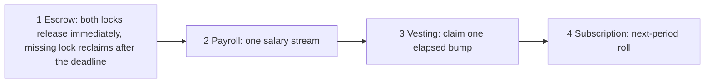

# Escrow first on the Default ring

Escrow is the first tool, and it is the weekend demo. Two people exchange something. Each locks what they give, a token or an NFT. Both approve before the start. Once both sides have locked, either side can release and take the other side's asset. A side can reclaim after the deadline if the other never locks. A sealed side has no cancel. Sunday shows that path in Pinocchio, Confidential, on the permissionless Default ring.

The sequence after escrow is payroll, then vesting, then subscription. They share one program. Payroll is not what ships first.

Payroll is next. The payer funds their own shielded account. The payee claims. There is one salary stream. On that stream the employer is the subscriber and signs `fund_current`. The employee is the issuer and claims. That mapping belongs to payroll. It is not the first escrow demo.

Vesting comes after payroll. The notes are weekly. A claim takes one elapsed bump, and the locked remainder stays sealed. A cliff is optional. Before the cliff, nothing is claimable. At the cliff, the weeks that have already elapsed can be claimed together. Later weeks still wait. A bonus can sit here as a second vested stream on the same payer. It is not a separate product launch.

Subscription is last. The next period has its own approval window. Pay at start and pay at end are both supported, and `roll` recurs under the frozen terms. The program includes that mode. It is not the demo.

Fee redistribution stays in the backlog. It uses the same partial-claim shape as vesting: the payer funds a position, and a recipient claims only the unlocked share. It is not a second program, and it is not a weekend blocker.

The program freezes two choices at `create_stream`: which ring, and whether the wallets are public or private. A stream does not migrate. All four combinations are options. Amount and asset stay in the note on every ring.

The permissionless Default ring with public wallets is the path that runs now. Its program id is `sppU489D7A4U1exNo1oeMGZtLEofq3a6o2fR7UeoWB6`. The two parties can read the token and the amount. A stranger cannot. The wallets are stored because that ring prints them. Private wallets on this ring are rejected: hiding them only on our account would be false.

A custom ring can keep the wallets public or keep them private. Public stores the pubkeys. Private stores commitments, and a relayer pays the fee. Both wait until Helius sets that ring's program id. The ring program id stays public either way.

A no-ring mode still exists. It stores the mint, the amount, the wallets, and the schedule in plaintext.

A ring is a shared pool of notes, each encrypted to its owner's viewing key. Same-ring readers cannot decrypt each other. On the permissionless ring with public wallets they also see the two addresses. They cannot decrypt another participant's amount, asset, or memo.

Landing time is public in every mode. The slot a release or a later claim lands in is visible, so a weekly vesting bump still reveals cadence.

Randomness, stated honestly, is the size of the pool. The permissionless ring's anonymity set is the open pool, not a hand-picked list and not one ring per person. Anyone may deposit. Custom rings, when Helius opens them, scope that pool to a need: a company, a payroll, or a fund. They do not scope it to a single user. A tiny ring is a worse set. This is not a Monero-style random decoy claim. Wallet privacy is the other choice. The permissionless ring does not provide it today.

The price stays in the note on every ring. Public wallets publish the relationship. Private wallets hide it only on a custom ring that does not print the owner, and only when this account stores commitments.
